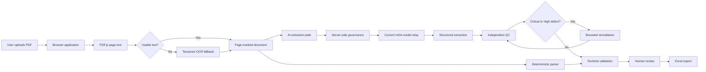

# Use Summary Tables Extractor

## Stakeholder Brief

**Owner:** Karandeep Singh, Bayer  
**BEAT:** `BEAT04090032`  
**Status:** Pilot / QA preparation  
**Audience:** Regulatory, product, security, AI platform, and engineering stakeholders

## Executive Summary

Use Summary Tables Extractor turns a pesticide product-label PDF into a structured, reviewable Use Summary Table. It identifies each crop/use-site and application-method combination, extracts the label-supported values into the 28-column schema, preserves page and evidence traceability, and produces a formatted Excel workbook.

The application is intentionally human-in-the-loop. It does not submit data to EPA, modify external systems, or make an unreviewed downstream decision. The user reviews the extracted rows, investigates warnings, edits where necessary, and explicitly exports the final workbook.

## The Problem

A pesticide label distributes critical information across crop tables, narrative directions, footnotes, restrictions, rate limits, and safety sections. Manual extraction typically takes 45–90 minutes per label and is vulnerable to missed rows, incorrect scope, conditional-rate loss, and inconsistent interpretation.

The tool addresses this by combining document parsing, regulatory extraction rules, independent quality control, provenance, and guided human review.

## What the User Does

1. Upload one or more pesticide-label PDFs.
2. Run the extraction in deterministic or AI-assisted mode.
3. Review rows grouped by source file.
4. Search, filter, sort, expand source evidence, and edit cells.
5. Resolve confidence and coverage warnings.
6. Complete the review stations.
7. Download the formatted Excel workbook.

## Current Architecture



### Two extraction modes

**Deterministic mode** runs locally in the browser. It is fast, repeatable, and does not consume model credits. It uses targeted patterns, crop vocabulary, derivation rules, confidence scoring, and schema validation.

**AI-assisted mode** sends the page-marked label through a server-side relay. The model receives the schema and extraction knowledge, emits structured rows, and is followed by a fresh independent QC conversation. Serious QC findings can trigger at most two remediation cycles using the stronger model.

## Trust and Control Design

- Every row carries a source file, page, and evidence trace.
- `NS` means the label does not state a value; `NA` means the field does not apply.
- Structured tool output constrains model responses to the table schema.
- Independent QC reviews the extraction in a fresh context.
- Runtime QC checks schema completeness, page ranges, evidence presence, and known gaps.
- Confidence and coverage warnings direct human attention to riskier rows.
- Users must review the output before export.
- Prompt-injection phrases are flagged for audit review; label text is treated as data, not instructions.
- Audit records contain metadata and estimated usage, not raw label text.
- Rate limits, a budget guard, and an emergency kill switch protect the model path.

## Failure Handling

- Scanned pages use OCR when the local OCR bundle is available.
- Invalid or oversized requests are rejected before model work.
- Gateway failures are surfaced to the user; AI failure does not silently fall back to a different result.
- Background jobs record an explicit error state if processing fails or input expires.
- Retries are bounded to avoid runaway cost and duplicate work.
- Remaining QC defects remain visible for human review.

## Target Production Architecture

The current pilot uses Cloudflare Pages/Workers and a server-side mGA credential. The target deployment is:

```text
Bayer user authenticated through central IAM/MFA
        |
        v
Agentrix/AWS-hosted application
        |
        v
Bayer AI Gateway using Entra M2M identity
        |
        v
Approved Claude model
```

The target removes the personal model credential from the runtime. AI Gateway onboarding is expected to provide governed model access, application attribution, usage visibility, and team/application budget controls. The exact non-production endpoint, OAuth scope/audience, model identifier, and secret-injection contract remain platform dependencies to confirm before implementation.

## Security and Governance Position

This is a bounded regulatory data assistant, not an autonomous submission agent.

**In scope:** label ingestion, extraction, validation, provenance, review, and workbook generation.  
**Out of scope:** automatic EPA submission, external-system writes, unsupervised decisions, and cross-label autonomous planning.

The planned deployment will use Bayer central IAM/MFA for users, Entra application identity for machine-to-machine AI Gateway calls, managed secrets, TLS-protected communication, and Agentrix/AWS platform controls. Platform-inherited controls must be confirmed by the hosting and AI Gateway owners during the security review.

## Demonstrated and Pending

### Demonstrated in the pilot

- PDF text extraction with page markers.
- Deterministic crop/use parsing.
- AI extraction with structured rows.
- Independent QC and bounded remediation.
- Search, filtering, sorting, source expansion, and inline editing.
- Formatted Excel export.
- Cost guardrails, audit metadata, and kill-switch support.
- SIVANTO, BYI seed-treatment, and Plenexos parser regression work.

### Pending for Agentrix + AI Gateway QA

- Confirm AI Gateway non-production endpoint and OAuth contract.
- Add `llm.read` permission for the correct non-production AI Gateway resource.
- Submit the AI Gateway onboarding request for the Entra application.
- Replace direct mGA calls with the approved AI Gateway client.
- Package the application as an Agentrix/AWS container with `/health`.
- Replace or redesign Cloudflare KV/Queue background infrastructure for the target runtime.
- Add OpenTelemetry `agent.run` and `gen_ai.chat` spans without prompts or label text.
- Verify team/application chargeback rather than personal model-budget usage.

## Success Criteria

The QA release is successful when a Bayer user can authenticate through the approved identity path, upload a representative label, receive a traceable table, review and export it, and the AI Gateway dashboard shows the usage under the approved application/team budget. No personal mGA credential is present in the deployed runtime.

## Stakeholder Decision Requests

1. Confirm whether the first target is QA only or QA followed immediately by production.
2. Confirm the approved model set and application/team budget.
3. Confirm the Agentrix runtime pattern: synchronous first release versus background processing in the first release.
4. Confirm ownership for platform-inherited security controls and evidence.
5. Confirm who signs off the human review and regulatory-use limitations.
